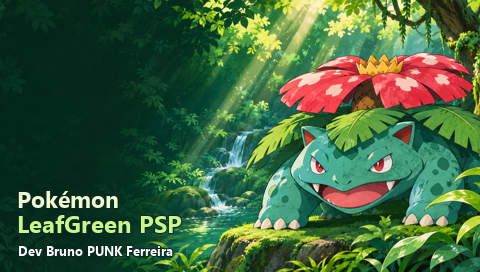
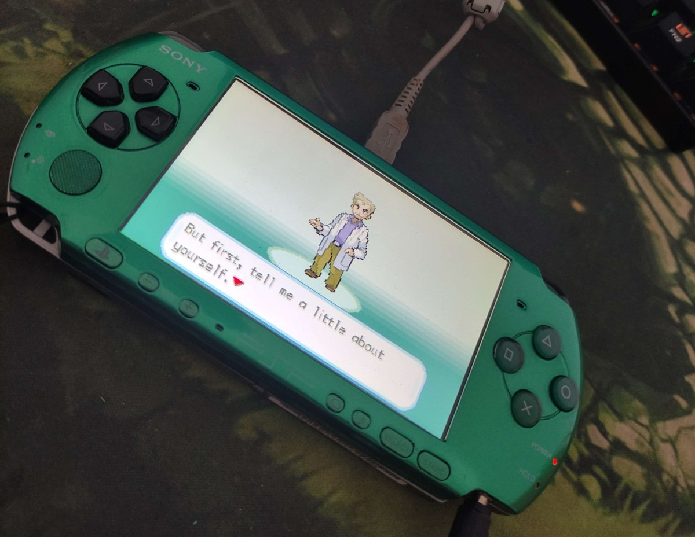

# Pokémon LeafGreen PSP



**Version 1.0 · English · Native PSP fan port**

Play Pokémon LeafGreen on a homebrew-enabled PlayStation Portable. The game is compiled for the PSP and uses the widescreen rendering, controller support and save system from the FireRed PSP project. The first hardware test reached gameplay and successfully saved, with no crashes reported during that session.



## Build on Linux or Ubuntu under WSL

Install Git, Make, GCC/G++, libpng development headers and the [PSPDEV toolchain](https://github.com/pspdev/pspdev). Set `PSPDEV` to the toolchain directory and add `$PSPDEV/bin` to `PATH`. Use a project path without spaces. Build with your own English Pokémon LeafGreen revision 1 cartridge dump.

```sh
bash build.sh /path/to/LeafGreen.gba
```

Copy the resulting `PSP` directory from `out/` to the root of your Memory Stick. On your PSP, open **Game → Memory Stick → Pokemon LeafGreen PSP**. For PPSSPP, copy the game folder into the emulator's Memory Stick or open the EBOOT from a folder outside the `PSP/GAME` hierarchy.

If you already played a test build, keep its game directory and save files when updating. The `FIRERED_PSP` folder name matches the inherited PSP port and the build used for testing.

## Credits

- **Dev Bruno PUNK Ferreira** — LeafGreen PSP adaptation, hardware testing and release.
- **JustKidding23 and contributors** — [Pokémon FireRed PSP platform layer](https://github.com/JustKidding23/Pokemon-FireRed-PSP).
- **pret and contributors** — [FireRed and LeafGreen decompilation](https://github.com/pret/pokefirered).

Pokémon and its characters belong to their respective rights holders. This is an unofficial fan project.
